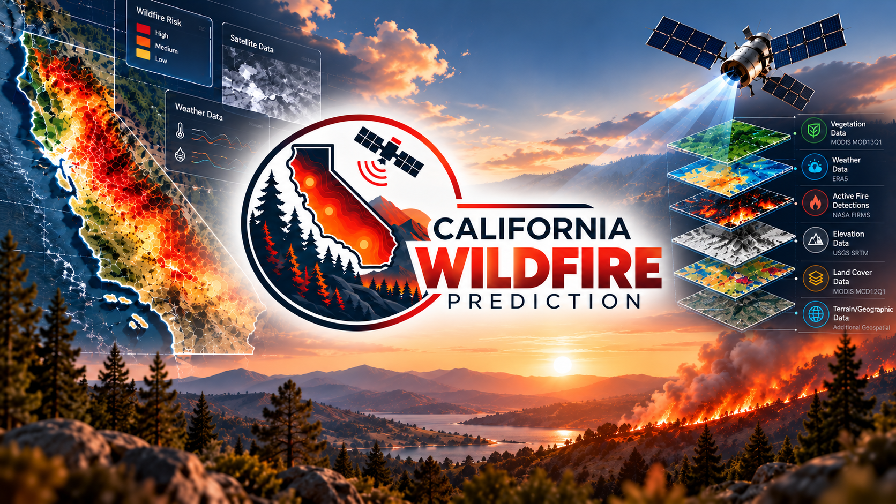
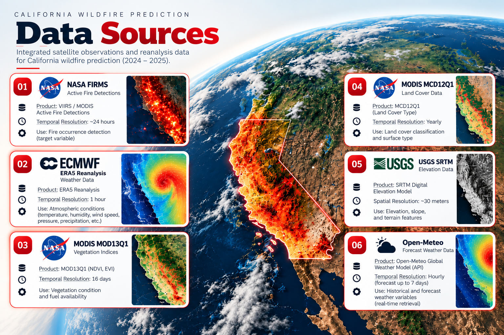
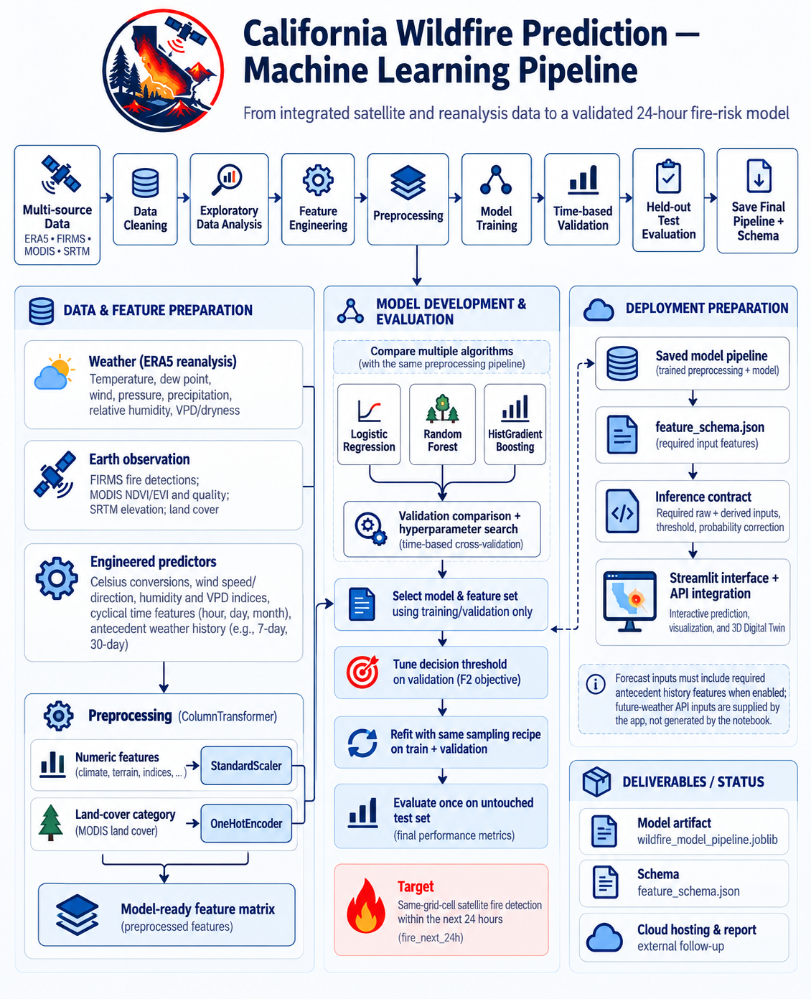
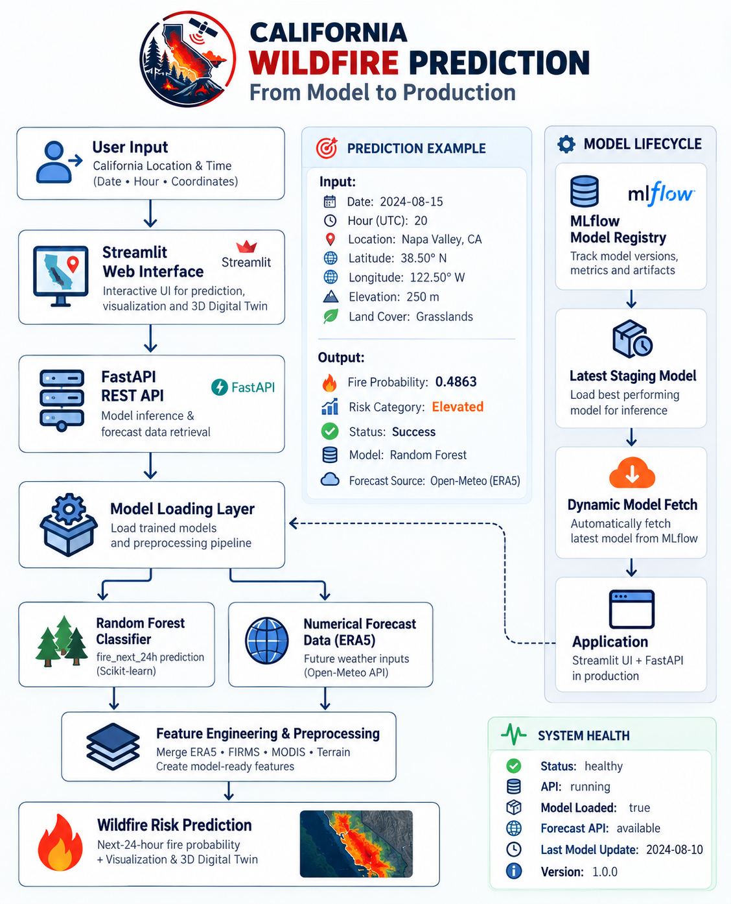

# California Wildfire Prediction & 3D Digital Twin

[](https://www.python.org/)
[](https://streamlit.io/)
[](https://scikit-learn.org/)
[](https://opensource.org/licenses/MIT)
[](https://github.com/AhmedShaban0/CaliforniaWildfire-Prediction-DigitalTwin)
[](https://california-wildfire.streamlit.app/)

An enterprise-grade geospatial machine learning intelligence platform and interactive 3D Digital Twin for forecasting next-24-hour wildfire detection risk across California. The system integrates Copernicus ERA5 atmospheric thermodynamics, NASA FIRMS spaceborne thermal anomaly telemetry, MODIS vegetative stress indices, and SRTM digital topography across a standardized 0.25° geographic grid (~25 km × 25 km).



---

## 🚀 Live Application & Repository

- **Live Streamlit Cloud Deployment:** [https://california-wildfire.streamlit.app/](https://california-wildfire.streamlit.app/)
- **GitHub Repository:** [https://github.com/AhmedShaban0/CaliforniaWildfire-Prediction-DigitalTwin](https://github.com/AhmedShaban0/CaliforniaWildfire-Prediction-DigitalTwin)

---

## 📋 Table of Contents

- [Project Overview](#-project-overview)
- [Key Features](#-key-features)
- [Data Sources](#-data-sources)
- [Data Processing & Feature Engineering](#-data-processing--feature-engineering)
- [Machine Learning Methodology](#-machine-learning-methodology)
- [Evaluation & Benchmark Results](#-evaluation--benchmark-results)
- [📌 Architecture & ML Workflow](#-architecture--ml-workflow)
- [Streamlit Application Walkthrough](#-streamlit-application-walkthrough)
- [Repository Structure](#-repository-structure)
- [Installation & Local Setup](#-installation--local-setup)
- [Deployment Guide](#-deployment-guide)
- [Scientific Limitations & Ethical Use](#-scientific-limitations--ethical-use)
- [Author & Acknowledgments](#-author--acknowledgments)
- [License](#-license)

---

## 🌍 Project Overview

Wildfires in California have grown in frequency, intensity, and economic devastation due to prolonged multi-year droughts, intensifying summer heatwaves, dry downslope wind events (Santa Ana and Diablo winds), and accumulating vegetative fuel loads. Traditional wildfire danger indices (e.g., NFDRS, CFFDRS) rely primarily on generalized weather station observations and empirical fire physics formulas that do not leverage dense spaceborne Earth observation telemetry or modern multivariate machine learning.

The **California Wildfire Prediction & Digital Twin** project addresses this challenge by formulating wildfire risk estimation as a machine learning classification task over space and time:

> **Target Definition (`fire_next_24h`):** Given all atmospheric, vegetative, and topographic observations available at hour $t$ for a specific 0.25° × 0.25° grid cell (~25 km × 25 km), estimate the empirical probability that NASA spaceborne sensors (MODIS / VIIRS) detect at least one active thermal wildfire anomaly within that same grid cell during the subsequent 24 hours ($t+1$ to $t+24$).

### Scope Boundary: Risk Prediction vs. Physical Spread Simulation
- **What this project delivers:** A calibrated statistical probability estimating spaceborne wildfire ignition and detection within the next 24 hours based on prevailing environmental conditions, fuel moisture deficit, and antecedent weather history.
- **What this project does not claim:** This system is **not a cellular automata flame spread simulator** (such as FARSITE or Prometheus) and does not compute computational fluid dynamics (CFD) fire ember transport or active flame front geometry.

### The Role of the 3D Digital Twin
The 3D Digital Twin provides an interactive, hardware-accelerated WebGL spatial environment that projects real-time environmental factors, SRTM digital elevation extrusion, and model-estimated risk overlays onto California's complex topography. This allows researchers, emergency planners, and land managers to visually contextualize how mountain passes, coastal valleys, and foothill microclimates interact with atmospheric fire drivers.

---

## ✨ Key Features

### 1. Dual-Mode Prediction Workflows
- **⚡ Real-time Prediction (Automated API Ingestion):**
  - Select from curated California regional hotspots (e.g., *Central Valley / Fresno*, *Sierra Foothills*, *Angeles National Forest*, *Napa Valley*, *Lake Tahoe Basin*, *Mendocino Coast*, *Paradise / Camp Fire Zone*, *Santa Barbara Coastal Range*, *San Diego / Cleveland Forest*, *Shasta-Cascade*).
  - Automatically queries the **Open-Meteo Global Weather Model API** for current and forward-projected hourly atmospheric thermodynamics (temperature, dewpoint, pressure, wind velocity, precipitation).
  - Computes 30-day antecedent accumulation metrics on the fly (24h, 7d, and 30d precipitation sum; 24h and 7d mean vapor pressure deficit; 7d mean temperature; 24h mean wind speed).
  - Fetches calibrated MODIS vegetative stress indices and SRTM elevation from static geographic caches, executing full model inference in under 500 ms.
- **⚙️ Manual Prediction (Custom Parameter Simulation):**
  - Interactive parameter controls for 2m air temperature, dewpoint temperature, surface atmospheric pressure, vector wind velocity, 10m wind direction, precipitation, vegetation stress (NDVI/EVI), and geographic coordinates.
  - Client-side physical validation enforcing atmospheric laws (e.g., vapor pressure deficit clipping, relative humidity saturation constraints, dewpoint $\le$ air temperature).
  - Real-time model inference dispatch returning raw model probabilities, prior-calibrated probabilities, operational alert status, and risk tier categorization.

### 2. Interactive California Geospatial Risk Maps
- **Leaflet 2D Interactive Map Engine:**
  - Real geographic basemaps: **Satellite Imagery (Esri World Imagery)**, **Terrain & Roads (CARTO Voyager)**, and **Dark Analytical (CARTO Dark Matter)**.
  - Interactive 0.25° risk polygon grid layer color-coded by standardized risk tiers:
    - 🟢 **Low Risk:** $< 15.0\%$
    - 🟡 **Moderate Risk:** $15.0\% - 25.0\%$
    - 🟠 **High / Alert:** $\ge 25.1\%$ (Exceeds optimal decision threshold $\tau = 0.2507$)
    - 🔴 **Extreme Risk:** $\ge 45.0\%$
  - Verified active fire telemetry: Displays genuine observed thermal anomalies from NASA FIRMS satellite overpasses.
  - Clickable grid cells with detailed telemetry popups displaying coordinates, elevation, land cover, and environmental telemetry.

### 3. Hardware-Accelerated 3D Digital Twin
- **WebGL Topographic Mesh Visualization:**
  - 3D spatial terrain extrusion powered by **PyDeck (deck.gl)** and **Plotly 3D Orbital Scatter**.
  - Interactive orbital camera controls: adjustable pitch ($0^\circ$ to $60^\circ$), bearing ($-180^\circ$ to $180^\circ$), and elevation scaling ($1.0\times$ to $6.0\times$).
  - Multi-layer visual switching: Model Predicted Risk, SRTM Elevation, Temperature, Vapor Pressure Deficit (VPD), Wind Magnitude, and NASA FIRMS active detections.
  - Pre-cached spatial snapshot engine (~480 KB) ensuring zero lag and instantaneous loading in cloud deployments.

### 4. Hourly Forecast Risk Curves & Environmental Dashboard
- **24-Hour Predictive Risk Trajectory:** Interactive glowing line chart illustrating forecasted wildfire risk trends across consecutive hourly forecast steps, identifying peak diurnal risk windows.
- **Key Environmental Factors Grid:** 9 atmospheric and terrestrial indicators (Temperature, Dewpoint, Vapor Pressure Deficit, Relative Humidity, Wind Speed & Direction, Surface Pressure, NDVI, EVI, Land Cover).

---

## 🛰️ Data Sources

The project integrates six distinct Earth observation and meteorological data sources, covering historical reanalysis, active spaceborne fire detection, vegetation condition, and real-time operational weather forecasts.



| # | Data Source | Provider | Product / Dataset | Spatial / Temporal Resolution | Project Functionality |
|---|---|---|---|---|---|
| **01** | **NASA FIRMS** | NASA Earthdata | VIIRS (S-NPP, NOAA-20) & MODIS (Aqua/Terra) | 375m / 1km pixel, ~24-hour cycle | Ground-truth active fire thermal anomalies; target variable construction (`fire_next_24h`). |
| **02** | **ECMWF ERA5** | Copernicus Climate Change Service | ERA5 Hourly Atmospheric Reanalysis | 0.25° (~25 km), hourly | Historical atmospheric thermodynamics ($t2m$, $d2m$, $u10$, $v10$, $sp$, $tp$). |
| **03** | **NASA MODIS MOD13Q1** | NASA LP DAAC | Vegetation Indices 16-Day Composite | 250m grid, 16-day cadence | Terrestrial fuel dryness & vegetative stress (NDVI, EVI, pixel reliability, VI quality). |
| **04** | **NASA MODIS MCD12Q1** | NASA LP DAAC | Land Cover Type Yearly | 500m grid, annual | Surface land cover categorization (IGBP classification scheme: Forests, Shrublands, Grasslands, Croplands, etc.). |
| **05** | **USGS SRTM** | NASA / USGS | Shuttle Radar Topography Mission (SRTM DEM) | 30m / 90m resolution, static | Topographic terrain features (Elevation, slope inclination, mountain barriers). |
| **06** | **Open-Meteo API** | Open-Meteo | Global Meteorological Model (ECMWF IFS / GFS) | Point-based downscaled, hourly up to 7 days | Runtime historical and forward forecast weather retrieval for automated live predictions. |

---

## 🔬 Data Processing & Feature Engineering

### Temporal Embargo & Zero-Leakage Splitting
To eliminate temporal and spatial data leakage between training and evaluation:
1. **Strict Chronological Partitioning:** Data was ordered chronologically into distinct training, validation, and test sets.
2. **24-Hour Causal Embargo Buffer:** A strict 24-hour embargo buffer was placed at each partition boundary ($t$ to $t+24$). Observations within this window were dropped to prevent antecedent features from overlapping with the target observation window of subsequent partitions.

### Model Feature Matrix (33 Features Total)
The production model contract ingests **33 features** (32 numeric, 1 categorical):

```text
Feature Schema (33 Features):
├── Atmospheric Instantaneous (6 features):
│   ├── u10                  : 10m zonal wind component (m/s)
│   ├── v10                  : 10m meridional wind component (m/s)
│   ├── t2m                  : 2m air temperature (Kelvin)
│   ├── d2m                  : 2m dewpoint temperature (Kelvin)
│   ├── sp                   : Surface atmospheric pressure (Pa)
│   └── tp                   : Total precipitation (meters)
├── Temporal & Cyclical (3 features):
│   ├── month                : Calendar month (1–12)
│   ├── hour                 : Hour of day (0–23 UTC)
│   └── day_of_year          : Ordinal day of year (1–366)
├── Spatial Coordinates (2 features):
│   ├── latitude             : Grid cell centroid latitude (°N)
│   └── longitude            : Grid cell centroid longitude (°W)
├── Terrestrial & Topographic (6 features):
│   ├── land_cover           : MODIS categorical land cover (IGBP class, OneHotEncoded)
│   ├── elevation            : USGS SRTM terrain elevation (meters above sea level)
│   ├── ndvi                 : Normalized Difference Vegetation Index (scaled float)
│   ├── evi                  : Enhanced Vegetation Index (scaled float)
│   ├── pixel_reliability    : MODIS optical observation reliability flag
│   └── vi_quality           : MODIS vegetation index quality bitmask
└── Antecedent Weather History (7 features):
    ├── tp_sum_24h           : Cumulative precipitation over past 24 hours (meters)
    ├── tp_sum_7d            : Cumulative precipitation over past 7 days (meters)
    ├── tp_sum_30d           : Cumulative precipitation over past 30 days (meters)
    ├── vpd_mean_24h         : Mean vapor pressure deficit over past 24 hours (kPa)
    ├── vpd_mean_7d          : Mean vapor pressure deficit over past 7 days (kPa)
    ├── t2m_mean_7d          : Mean 2m temperature over past 7 days (°C)
    └── wind_mean_24h        : Mean wind speed over past 24 hours (m/s)
```

### Preprocessing Pipeline (`ColumnTransformer`)
- **Numerical Pipeline:** Missing values imputed via median strategy; scaled using `StandardScaler()`.
- **Categorical Pipeline:** `land_cover` encoded via `OneHotEncoder(handle_unknown='ignore', dtype=float32)`.

---

## 🤖 Machine Learning Methodology

### Model Selection & Benchmark Candidates
Three machine learning architectures were trained and evaluated using the identical preprocessing pipeline and time-series validation scheme:
1. **Logistic Regression (Baseline):** Linear decision boundary with $L_2$ regularization.
2. **HistGradientBoostingClassifier:** Fast histogram-based gradient-boosted decision trees.
3. **RandomForestClassifier (Selected Production Model):** Ensemble of 200 de-correlated decision trees configured with:
   - `n_estimators = 200`
   - `max_features = 0.5`
   - `max_samples = 0.3`
   - `min_samples_leaf = 5`
   - `n_jobs = -1`
   - `random_state = 42`

### Class Imbalance & Prior-Shift Odds Correction
Active wildfire detection events are rare in space and time (natural California occurrence prevalence $\pi_{\text{nat}} \approx 6.04\%$). Training sets were subsampled to an effective prevalence of $\pi_{\text{eff}} = 27.16\%$ to accelerate convergence and gradient stability.

To recover mathematically sound natural posterior probabilities during inference, the pipeline applies Bayes' rule prior-shift correction:

$$\text{odds}_{\text{nat}} = \text{odds}_{\text{model}} \times \frac{\pi_{\text{nat}} / (1 - \pi_{\text{nat}})}{\pi_{\text{eff}} / (1 - \pi_{\text{eff}})}$$

$$p_{\text{calibrated}} = \frac{\text{odds}_{\text{nat}}}{1 + \text{odds}_{\text{nat}}}$$

### Decision Threshold Optimization
Rather than using an arbitrary 50% cutoff, the operational decision threshold was tuned on the chronological validation split to optimize the **$F_2$-score** ($\beta = 2.0$), which places twice the emphasis on recall (catching fires) relative to precision (avoiding false alarms):

$$\tau^* = 0.2507$$

---

## 📈 Evaluation & Benchmark Results

### Held-Out Chronological Test Set Performance (400,000 Observations)
All performance metrics below were computed on strictly held-out chronological test observations and independently verified from the canonical training notebook:

| Evaluation Metric | Tuned Production Model ($\tau = 0.2507$) | Default Baseline ($\tau = 0.5000$) | Interpretation & Operational Impact |
|---|---|---|---|
| **PR-AUC (Average Precision)** | **0.4863** | **0.4863** | Threshold-invariant; **8.3× improvement** over the 0.0585 no-skill baseline. |
| **ROC-AUC** | **0.8844** | **0.8844** | Exceptional discrimination between wildfire and non-wildfire cells. |
| **Recall (Wildfires Detected)** | **70.78%** | 51.63% | **Captures >70% of all wildfire detection events** across California. |
| **Precision** | **29.08%** | 49.56% | Controlled operational precision under natural class imbalance (6.04%). |
| **$F_1$-Score** | **0.4123** | 0.5058 | Balanced harmonic mean of precision and recall. |
| **$F_2$-Score ($\beta = 2.0$)** | **0.5501** | 0.5121 | **Primary optimization objective** weighting recall twice as heavily. |
| **Overall Accuracy** | **88.20%** | 94.10% | High general classification accuracy across the California spatial grid. |
| **Operational Alert Rate** | **14.23%** | 6.09% | Practical alert volume manageable by regional dispatch centers. |
| **No-Skill PR-AUC Baseline** | 0.0585 | 0.0585 | Random guessing baseline equal to natural class prevalence. |

---

## 📌 Architecture & ML Workflow

### Machine Learning Pipeline Diagram
The complete end-to-end data lifecycle from multi-source ingestion through exploratory data analysis, time-series validation, hyperparameter optimization, threshold tuning, and artifact serialization:



*Figure 1: End-to-end Machine Learning Pipeline from multi-source satellite and reanalysis ingestion through time-based validation, threshold tuning, and production artifact export.*

### Model to Production Architecture Diagram
The runtime architecture illustrating user interactions, automated Open-Meteo weather forecast retrieval, feature preprocessors, Random Forest classifier, and dynamic model lifecycle:



*Figure 2: Model to Production Architecture illustrating user interaction, Open-Meteo API weather retrieval, model inference pipeline, and dynamic model lifecycle.*

---

## 🖥️ Streamlit Application Walkthrough

The application is structured into specialized views accessible via the responsive sidebar:

| Application Page | Module File | Description & Functionality |
|---|---|---|
| **🔥 Wildfire Prediction** | `pages_impl/prediction.py` | Primary interactive prediction workspace. Includes Real-time & Manual prediction modes, California regional presets, Leaflet 2D risk map with basemap switcher, 9-parameter environmental grid, and 24-hour hourly risk forecast curve. |
| **📊 Overview** | `pages_impl/overview.py` | Statewide executive dashboard displaying real-time wildfire risk metrics, thermal anomaly counts, weather summaries, and recent NASA FIRMS satellite detections. |
| **🗺️ Interactive Map** | `pages_impl/interactive_map.py` | Fullscreen Leaflet geospatial map engine featuring Satellite, Terrain, and Dark Matter basemaps with interactive risk grid inspection. |
| **🌐 3D Digital Twin** | `pages_impl/digital_twin.py` | Hardware-accelerated 3D topographic terrain twin powered by deck.gl / PyDeck and Plotly 3D WebGL orbital scatter with dynamic layer switching. |
| **📈 Model Performance** | `pages_impl/performance.py` | Interactive test set diagnostic suite featuring PR-AUC, ROC-AUC, Confusion Matrix, $F_\beta$ threshold curves, and permutation feature importance. |
| **🔬 Data & Methodology** | `pages_impl/methodology.py` | Scientific documentation of multi-sensor data ingestion, causal embargo buffers, sampling recipes, and prior-shift odds calibration. |
| **ℹ️ About** | `pages_impl/about.py` | Project background, technical architecture, responsible-use disclosures, and scientific data citations. |

---

## 📂 Repository Structure

```text
CaliforniaWildfire-Prediction-DigitalTwin/
├── .streamlit/
│   └── config.toml                        # Streamlit dark navy theme tokens & server settings
├── assets/
│   ├── Project_Image.png                  # Main project cover banner
│   ├── data-sources.png                   # 6-source Earth observation & weather infographic
│   ├── ML_Pipeline.png                    # Machine Learning Pipeline diagram
│   ├── ModeltoProduction.png              # Model to Production architecture diagram
│   ├── wildfire.png                       # Primary circular project logo
│   ├── wildfire.jpg                       # Original visual branding asset
│   ├── fire_thumb.jpg                     # Satellite thermal detection thumbnail
│   ├── location_thumb.jpg                 # California landscape thumbnail
│   ├── curated_snapshots.parquet          # Pre-cached 3D Digital Twin snapshot (~480 KB)
│   ├── california_grid_static.parquet     # Static grid elevation & land cover cache (~24 KB)
│   └── regions/                           # 10 Regional California landscape thumbnails
│       ├── angeles_forest.jpg
│       ├── central_valley.jpg
│       ├── lake_tahoe.jpg
│       ├── mendocino_coast.jpg
│       ├── napa_valley.jpg
│       ├── paradise_butte.jpg
│       ├── santa_barbara.jpg
│       ├── san_diego_cleveland.jpg
│       ├── shasta_cascade.jpg
│       └── yosemite_mariposa.jpg
├── pages_impl/
│   ├── about.py                           # About & scientific citation page
│   ├── digital_twin.py                    # 3D Digital Twin (deck.gl & Plotly WebGL)
│   ├── interactive_map.py                 # Fullscreen Leaflet 2D map engine
│   ├── methodology.py                     # Scientific data pipeline & methodology
│   ├── overview.py                        # Statewide executive situational dashboard
│   ├── performance.py                     # Verified test evaluation benchmarks & curves
│   └── prediction.py                      # Primary dual-mode prediction workspace
├── src/
│   ├── data_loader.py                     # Dataset loading, caching, and Open-Meteo weather API
│   ├── leaflet_map.py                     # Responsive Leaflet HTML/JS component generator
│   ├── model_loader.py                    # Pipeline deserialization, schema validation, odds calibration
│   ├── theme.py                           # Dark navy UI styling tokens & component helpers
│   └── twin_3d.py                         # 3D terrain polygon builders & deck.gl visualizer
├── tests/
│   └── test_redesign_verification.py      # Unit test suite (basemaps, polygons, risk tiers, UI)
├── ARCHITECTURE_AND_VERCEL_EVALUATION.md  # Architectural evaluation report & hosting analysis
├── California_Wildfire_ML_final_5_improved.ipynb # Canonical 99-cell ML training notebook
├── DEPLOYMENT.md                          # Comprehensive cloud deployment instructions
├── Dockerfile                             # Production Docker container specification
├── LICENSE                                # MIT License
├── ML_Pipeline.png                        # Root architecture diagram
├── ModeltoProduction.png                  # Root model-to-production diagram
├── README.md                              # Comprehensive project documentation
├── app.py                                 # Streamlit application main entry point
├── feature_schema.json                    # Machine-readable model schema & winsorization bounds
├── requirements.txt                       # Pinned production runtime dependencies
└── wildfire_model_pipeline.joblib         # Fitted Scikit-Learn Pipeline artifact (~91 MB)
```

---

## 💻 Installation & Local Setup

### Prerequisites
- Python 3.11 or 3.12 (recommended)
- Git

### 1. Clone the Repository
```bash
git clone https://github.com/AhmedShaban0/CaliforniaWildfire-Prediction-DigitalTwin.git
cd CaliforniaWildfire-Prediction-DigitalTwin
```

### 2. Create and Activate Virtual Environment
```bash
# Windows PowerShell:
python -m venv .venv
.\.venv\Scripts\Activate.ps1

# Linux / macOS:
python3 -m venv .venv
source .venv/bin/activate
```

### 3. Install Dependencies
```bash
pip install --upgrade pip
pip install -r requirements.txt
```

### 4. Run Test Suite
```bash
python -m unittest discover tests
```

### 5. Launch Application
```bash
streamlit run app.py
```
Open your browser to `http://localhost:8501`.

---

## ☁️ Deployment Guide

### Streamlit Community Cloud (Current Production)
The application is pre-configured for zero-configuration deployment on **Streamlit Community Cloud**:
1. Connect your GitHub account to [share.streamlit.io](https://share.streamlit.io/).
2. Select repository: `AhmedShaban0/CaliforniaWildfire-Prediction-DigitalTwin`.
3. Set branch: `main`.
4. Set main file path: `app.py`.
5. Deploy. The application uses pre-cached static assets (`assets/curated_snapshots.parquet` and `assets/california_grid_static.parquet`), enabling sub-second startup without requiring multi-gigabyte raw dataset downloads.

### Docker Deployment
```bash
# Build Docker image
docker build -t california-wildfire-twin .

# Run container
docker run -p 8501:8501 california-wildfire-twin
```
Access at `http://localhost:8501`.

---

## ⚠️ Scientific Limitations & Ethical Use

- **Statistical Risk vs. Flame Physics:** This platform estimates the empirical probability of a spaceborne thermal detection within a 0.25° grid cell. It **does not simulate cellular automata fire spread, flame lengths, or CFD ember transport**.
- **Satellite Detection Constraints:** Spaceborne infrared sensors (VIIRS / MODIS) can be obstructed by dense cloud cover, heavy smoke plumes, or thick forest canopies. Small or understory fires may not be detected during satellite overpasses.
- **Not an Emergency Dispatch System:** Predictions are provided strictly for research, planning, and situational awareness. They do not constitute official evacuation alerts or operational firefighting directives. Always consult CAL FIRE, the National Weather Service (NWS), and local emergency authorities during active wildfire events.

---

## 👥 Author & Acknowledgments

- **Lead Developer & Machine Learning Engineer:** Ahmed Shaban ([GitHub: @AhmedShaban0](https://github.com/AhmedShaban0))
- **Data Providers:**
  - **ECMWF ERA5 Reanalysis:** Copernicus Climate Change Service.
  - **NASA FIRMS:** NASA Earth Science Data and Information System (ESDIS).
  - **NASA MODIS:** NASA Land Processes Distributed Active Archive Center (LP DAAC).
  - **USGS SRTM:** United States Geological Survey & NASA Jet Propulsion Laboratory.
  - **Open-Meteo:** Open-Meteo Weather API.

---

## 📄 License

This project is licensed under the **MIT License** — see the [LICENSE](LICENSE) file for complete details.
